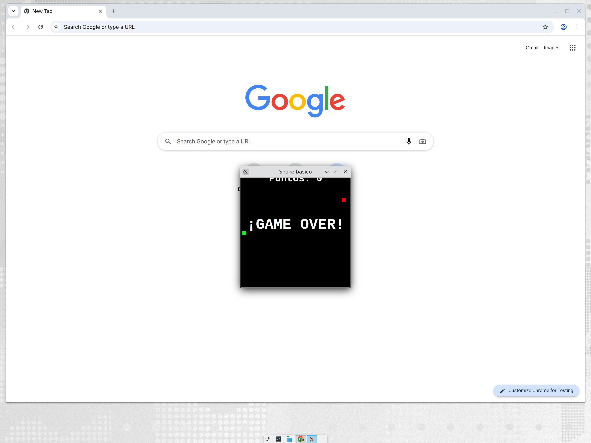

# Snake con `turtle` — cuaderno y juego

Versión extremadamente básica del **Snake** (la serpiente, un jugador) con la
librería estándar `turtle` de Python, pensada para clase.

- **`snake-turtle.ipynb`** — cuaderno explicativo paso a paso (el reloj
  `ontimer`, la lista que es el cuerpo, dirección como estado, arrastre
  trozo a trozo, colisiones por distancia) con el código completo al final
  y retos de ampliación. Ábrelo directamente en Colab:

  [](https://colab.research.google.com/github/maximofernandezriera/snake-turtle/blob/main/snake-turtle.ipynb)

- **`snake.py`** — el juego completo (~100 líneas comentadas en castellano).

> `turtle` abre una ventana real: el juego se ejecuta en tu equipo
> (IDLE, Thonny, VS Code o terminal: `python3 snake.py`) o en un
> Codespace con escritorio web — no dentro de Colab.

## Ejecutarlo en el navegador (sin instalar nada)

**Guía completa paso a paso:** [`GUIA-DE-USO.md`](GUIA-DE-USO.md).
Resumen rápido:

### Opción A — GitHub Codespaces con escritorio web

Este repo incluye `.devcontainer/devcontainer.json` con escritorio Linux
accesible desde el navegador (noVNC):

1. En GitHub: **Code → Codespaces → Create codespace on main**
   (la primera vez tarda unos 3-5 min en construirse).
2. Cuando abra VS Code web, ve a la pestaña **PORTS**, busca el puerto
   **6080** ("Escritorio web") y abre la URL en otra pestaña.
3. En esa pestaña verás un escritorio Linux: contraseña **`vscode`**.
4. De vuelta en el terminal de VS Code, ejecuta (el escritorio web es el
   display `:1`):

   ```bash
   DISPLAY=:1 python3 snake.py
   ```

   La ventana del juego aparece **dentro del escritorio web** de la
   pestaña del puerto 6080. El teclado funciona ahí directamente.

### Opción B — Trinket (cero preparación)

1. Abre https://trinket.io → **New Trinket → Python**.
2. Pega el contenido de `snake.py` y pulsa **Run**.

### Opción C — En tu equipo

`python3 snake.py` (Windows: `python snake.py`), IDLE o Thonny.

## Controles

Flechas **↑ ↓ ← →**. Come los cuadrados rojos para crecer; chocar con el
borde o contigo mismo termina la partida.


